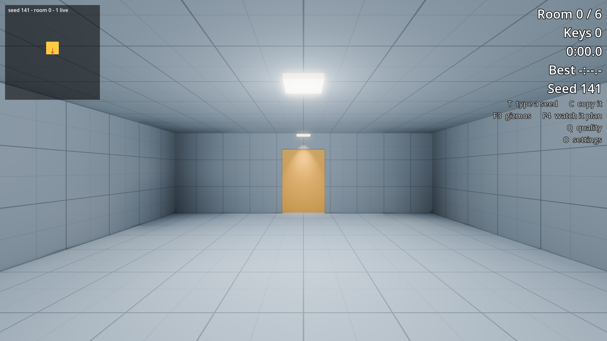

# Numbered Doors in Godot 4

Project files for tutorial 11 of the Godot 4 series by Phaix on YouTube (https://www.youtube.com/@Phaix).

Put the room number on every door of a Godot 4.7 run whose rooms are built while the game plays. A Label3D on the swinging leaf, a child of the hinge, so the number turns with the door and no code moves it. Z-fighting shown in footage, the depth buffer behind it, and a number floated one centimeter in front of the leaf with 21 steps of margin. A size chosen by measuring: the height of a digit in pixels at 1080p from the farthest corner of the longest room, against the 18 px (PC) and 26 px (TV) text floors of the Xbox Accessibility Guidelines. A number that comes from the generator's plan and never from a counter, proven by a headless walk of 200 seeds, 4000 doors, none with a wrong number, through freed rooms, a restart and a new seed. A readability pass: dark digits, a light rim, no back, contrast ratios measured in the rendered frame, and facing checked in all six room types. The last tutorial of the series. Every step is its own project folder.



## Steps

Every step of the video is its own folder in `steps/`, the exact state at the end of that
part. Open the project in Godot 4.7, then open `steps/<step>/main.tscn` and press F6 to run
that step. The project's main scene is the final step.

| Folder | Part of the video |
|---|---|
| `steps/step_00_start` | Starting point (the final state of the previous tutorial) |
| `steps/step_01_label_on_the_leaf` | Step 1 - A Label3D on the leaf |
| `steps/step_02_numbers_from_the_chain` | Step 2 - The number comes from the plan |
| `steps/step_03_readability_pass` | Step 3 - A readability pass |

## Controls

WASD or arrow keys or the left stick to walk, mouse or right stick to look, Space to jump,
Esc gives the mouse back, a click captures it again. Further keys per tutorial are shown
in the video and in the HUD.

## Tests

```sh
godot --headless --path . -s res://tests/run_tests.gd
```

## License

Code and scenes: MIT (see LICENSE).
